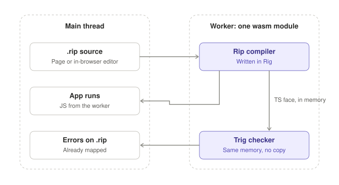

# The Rip compiler pipeline

How a `.rip` file becomes running JavaScript, and how the same compile
feeds the type checker.

One compile — `compile()` in [src/compiler.js](../src/compiler.js) —
runs the same stages for every consumer: the Bun loader, the browser,
`rip check`, and the editor. They differ only in which face they ask
the emitter for and how runtimes are delivered.

## 1. Lexer — scanner and rewriter passes

[src/lexer.js](../src/lexer.js) scans source text into a token tape:
tokens plus trivia (comments, whitespace), each carrying a
`[start, end)` span in UTF-16 code units.

The scanner's tokens then pass through a fixed sequence of rewriter
passes, in this order:

| pass | owner | what it settles |
|---|---|---|
| `tagParams`, `tagDynamicKeys`, `tagVoidMarkers` | lexer.js | arrow parameter lists, bracketed object keys (`{a[i]: v}`), `name!` definitions |
| `rewriteSchema` | [schema.js](../src/schema.js) | `schema` bodies |
| `rewriteTypes` | [types.js](../src/types.js) | type annotations and declarations |
| `rewriteRender` | [render.js](../src/render.js) | `render` templates |
| `tagCompoundKeys` | lexer.js | dotted and dashed keys (`{ data-src: 1 }`) |
| `implicitBlocks` | [implicit.js](../src/implicit.js) | indentation blocks (`then` bodies) |
| `tagPostfixConditionals` | lexer.js | postfix `if`/`unless` |
| `implicitObjects`, `implicitCalls` | implicit.js | braceless objects, parenthesis-free calls |
| `tagLooseElse`, `rejectDoTails`, `insertArrowCommas` | lexer.js | loose `then`/`else`, `do (…)` tails, commas before arrow arguments |

Each pass either retags tokens or inserts generated ones (an implicit
`CALL_START`, `INDENT`, `{`), so the grammar sees fully explicit
structure. A pass that finds invalid input rejects it with a positioned
error.

## 2. Parser — LALR(1)

[src/parser.js](../src/parser.js) is generated by Solar
([src/grammar/solar.rip](../src/grammar/solar.rip)) from
[src/grammar/grammar.rip](../src/grammar/grammar.rip). Never edit it by
hand: change the grammar and run `bun run parser`. CI checks the
committed table byte for byte. Every conflict the table resolves by
default rather than by declared precedence is listed, with its reason,
in the grammar's `expectedConflicts` manifest; generation fails when
the table drifts from it.

## 3. S-expressions and side tables

Grammar actions build an s-expression tree (`["=", target, value]`,
`["if", cond, then, else]`, …). Spans, roles and node kinds do not live
on the tree. They live in side tables keyed by node id, built by
[src/builder.js](../src/builder.js) and queried through
[src/stores.js](../src/stores.js):

- **NodeStore**: each node's kind, rule and source span;
- **RoleStore**: which child plays which role (`condition`, `body`, …),
  from the grammar's role annotations;
- **MappingStore**: generated ↔ source mappings, filled in during
  emission.

## 4. Emitter — one emission, two faces

[src/emitter.js](../src/emitter.js) lowers the tree to output text and
records every mapping as it writes. It produces one of two faces:

- **JavaScript face** (`face: 'js'`, the default) is what runs. Types
  are erased by the emitter itself; TypeScript never touches the
  shipping path.
- **TypeScript face** (`face: 'ts'`) is the same emission plus type
  syntax. Every TS-only span is recorded (`tsRegions`), and deleting
  them reproduces the JavaScript face byte for byte, so the checked
  program is exactly the program that runs.

Programs that use a feature runtime (reactivity, components, schema)
receive it according to `runtimeDelivery`: `inline` (self-contained
output, the default), `import` (the toolchain's shared runtime module),
or `none` (the browser, whose loader provides the runtime bindings).

## 5a. The shipping path — JavaScript

- **Bun**: [src/loader.js](../src/loader.js) is a Bun plugin
  (preloaded by the `rip` CLI or a project's `bunfig.toml`). Any
  `import` of a `.rip` module compiles at load time, through the
  compile cache ([src/cacher.js](../src/cacher.js)), with source maps
  registered so stack traces point at `.rip` lines.
- **Browser**: `dist/@rip/rip.js`, built from
  [src/browser.js](../src/browser.js), carries the whole compiler and
  the browser-safe runtimes. A page's `<script type="text/rip">` tags,
  or a Rip Sites publication's source list
  ([docs/WORKSPACE.md](WORKSPACE.md)), arrive as Rip source and compile
  in the page.

## 5b. The type-check path — TypeScript, never shipped

`rip check` ([src/cli/check.js](../src/cli/check.js)) and the VS Code
extension ([packages/vscode](../packages/vscode)) compile each file's
TypeScript face into a mirror tree and run `tsgo` (TypeScript 7,
written in Go) over it. Diagnostics, hovers and semantic tokens map
back to `.rip` positions through the MappingStore. The editor and
`rip check` share that machinery, so they report the same errors.
[docs/TYPES.md](TYPES.md) covers the type system and editor
architecture.

## Where this is heading: checking in the browser

Everything above runs today. The browser already compiles Rip in-page,
but it does not type-check: `tsgo` is a native binary, so checking
lives in `rip check` and the editor. Two further steps bring the
checker into the page. Neither is built.

**Step 1: a wasm checker in a Web Worker.** `rip.js` keeps compiling on
the main thread and posts the TypeScript face to a worker. The worker
runs a TypeScript checker compiled to wasm, with the TypeScript lib
files and the runtime declarations loaded in memory, and posts back
diagnostics in TypeScript positions. Rip maps them onto the `.rip`
source exactly as `rip check` does. tsrs ships such a build today
(`@tsrs/wasm`); Trig, our own checker written in Rig, takes the same
slot once Rig can target wasm32.

**Step 2: one wasm module.** With the Rip compiler itself written in
Rig, the compiler and Trig build into a single wasm module that shares
one memory. The TypeScript face goes from the emitter to the checker
without being copied or reparsed, and the worker returns both the
JavaScript to run and diagnostics already mapped to `.rip`. The main
thread keeps only what needs the DOM: the source, the running app, and
the errors on screen. The same Rig code built natively serves `rip
check` and the editor, so every host runs one engine.

What each step waits on:

| step | needs |
|---|---|
| 1, with tsrs | `@tsrs/wasm` in a worker, and a checker seam that passes files as messages instead of writing a mirror directory |
| 1, with Trig | a wasm32 backend for Rig's runtime; a language service in Trig |
| 2 | the above, plus the Rip compiler written in Rig ([CLEANROOM.md](CLEANROOM.md) chooses the engine language) |

In-browser checking serves playgrounds, in-browser editors and
development. A production page never needs the checker, so it never
pays for one.
