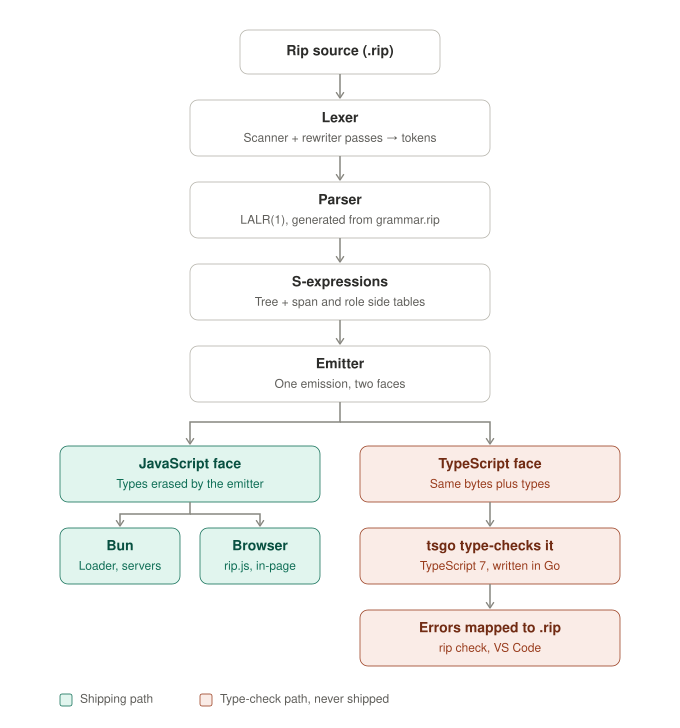
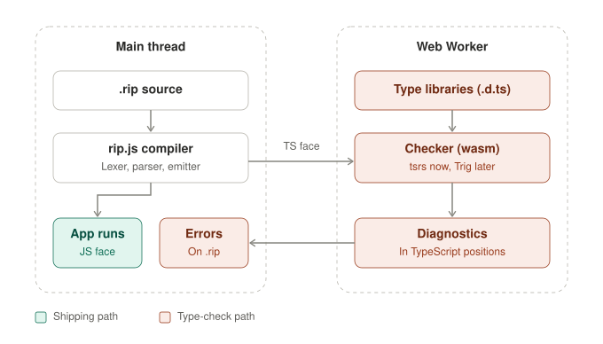

# The Rip compiler pipeline

How a `.rip` file becomes running JavaScript, and how the same compile
feeds the type checker.

One compile — `compile()` in [src/compiler.js](../src/compiler.js) —
runs the same stages for every consumer: the Bun loader, the browser,
`rip check`, and the editor. They differ only in which face they ask
the emitter for and how runtimes are delivered.

## 1. Lexer — scanner and rewriter passes

[src/lexer.js](../src/lexer.js) scans source text into a token tape:
tokens plus trivia (comments, whitespace), each carrying a
`[start, end)` span in UTF-16 code units.

The scanner keeps a stack of mode frames for the contexts that change
how a word or glyph scans (render templates, type bodies, class and
component bodies, module lines, `for` heads, schemas). A `schema`
declaration is its own small language: inside one the scanner emits the
schema alphabet (every word a name, `:word` a symbol, tight `!`/`?`
modifiers, a terminal per code-bearing directive family) and cuts the
body from the tape. The tape keeps `SCHEMA` and `SCHEMA_BODY`; the body
rides beside `SCHEMA_BODY` as its payload. Embedded Rip inside a body
(member bodies, transforms, `@ensure` predicates, the `on:` adapter) is
scanned as program code and cut into `SCHEMA_CODE` islands, each ended
by its own written exit rule.

The scanner's tokens then pass through a fixed sequence of rewriter
passes, in this order:

| pass | owner | what it settles |
|---|---|---|
| `retagTape` | lexer.js | arrow parameter lists, bracketed object keys (`{a[i]: v}`), `name!` definitions (one walk) |
| `rewriteTypes` | [types.js](../src/types.js) | type annotations and declarations |
| `rewriteRender` | [render.js](../src/render.js) | `render` templates |
| `tagCompoundKeys` | lexer.js | dotted and dashed keys (`{ data-src: 1 }`) |
| `implicitBlocks` | [implicit.js](../src/implicit.js) | indentation blocks (`then` bodies) |
| `tagPostfixConditionals` | lexer.js | postfix `if`/`unless` |
| `implicitObjects`, `implicitCalls` | implicit.js | braceless objects, parenthesis-free calls |
| `finishLayout` | lexer.js | loose `then`/`else`, `do (…)` tails, commas before arrow arguments (one walk) |

Each pass either retags tokens or inserts generated ones (an implicit
`CALL_START`, `INDENT`, `{`), so the grammar sees fully explicit
structure. A pass that finds invalid input rejects it with a positioned
error. The passes run over the tape, then over each schema island.

## 2. Parser — LALR(1)

[src/parser.js](../src/parser.js) is generated by Solar
([src/grammar/solar.rip](../src/grammar/solar.rip)) from
[src/grammar/grammar.rip](../src/grammar/grammar.rip). Never edit it by
hand: change the grammar and run `bun run parser`. CI checks the
committed table byte for byte. Every conflict the table resolves by
default rather than by declared precedence is listed, with its reason,
in the grammar's `expectedConflicts` manifest; generation fails when
the table drifts from it.

The one table has more than one start symbol. Besides the program's
`Root`, each grammar **entry** names a start symbol and the terminals
that head it. Such a token carries a payload, a token list the lexer
keeps beside it, and the driver parses that payload from the entry's
start state on the same stack before it shifts the token. The token's
value is then `[kind, {}, raw, body]`, and payloads nest.

- **Types**: `rewriteTypes` collapses each annotation into one `TYPE`,
  `CAST` or `SATISFIES` token, keeps the annotation's tokens as its
  payload, and the payload parses from `TypeAnnotation` into `type-*`
  nodes. The types entry is opaque: a payload its grammar rejects keeps
  its raw text and the body `["none", {}]`, and the parse reports
  nothing, since the checker owns that annotation's verdict.
- **Schemas**: a `SCHEMA_BODY` payload parses from `SchemaBody` into
  `schema-*` nodes, and each `SCHEMA_CODE` island inside it parses from
  the program's own `Root`. Neither is opaque: a rejection is the
  parse's own error, positioned, with the schema line's own message
  where the reader has one (the lexer's `explain`). Once the parse
  accepts, [src/schema.js](../src/schema.js) reads each schema's tree
  into its descriptor, the value the emitter serializes (the lexer's
  `finish`), applying what the vocabulary and the kinds decide.

An entry's states come after the program's, so adding one never
renumbers a program state, and Solar fails generation when any entry
state holds two actions for one token.

## 3. S-expressions and side tables

Grammar actions build an s-expression tree (`["=", target, value]`,
`["if", cond, then, else]`, …). Spans, roles and node kinds do not live
on the tree. They live in side tables keyed by node id, built by
[src/builder.js](../src/builder.js) and queried through
[src/stores.js](../src/stores.js):

- **NodeStore**: each node's kind, rule and source span;
- **RoleStore**: which child plays which role (`condition`, `body`, …),
  from the grammar's role annotations;
- **entry values**: every entry token's value in source order
  (`stores.entryValue(nodeId)`). A rule that erases a type annotation
  from the tree still records it as a side-band role, and that role's
  `childNodeId` names the annotation's value here;
- **MappingStore**: generated ↔ source mappings, filled in during
  emission.

## 4. Emitter — one emission, two faces

[src/emit/emitter.js](../src/emit/emitter.js) lowers the tree to output text
and records every mapping as it writes. Its `Emitter` class
([src/emit/core.js](../src/emit/core.js)) holds the dispatch, grouping and
marks; the per-construct lowerings live in area modules beside it (one
carrier class each, installed onto `Emitter` at load). It produces one of
two faces, and `emit()` constructs the face's class:

- **JavaScript face** (`face: 'js'`, the default) is what runs. Types
  are erased by the emitter itself; TypeScript never touches the
  shipping path.
- **TypeScript face** (`face: 'ts'`) is the same emission plus type
  syntax. Every TS-only span is recorded (`tsRegions`), and deleting
  them reproduces the JavaScript face byte for byte, so the checked
  program is exactly the program that runs. Its class, `TsEmitter`
  ([src/emit/face.js](../src/emit/face.js)), extends `Emitter`. A
  lowering both faces share reaches TS-only code in two ways: through
  the face seam ([src/emit/hooks.js](../src/emit/hooks.js)), whose
  members do the JS face's part and which `TsEmitter` overrides (and
  nothing else, checked at load), or by calling a `TsEmitter` member
  under a `this.ts` test. Beyond the annotation normalizer, no module
  but face.js imports from `src/ts/`, so the browser bundle, which emits JS alone, replaces
  face.js with a stub whose `TsEmitter` rejects construction.

Programs that use a feature runtime (reactivity, components, schema)
receive it according to `runtimeDelivery`: `inline` (self-contained
output, the default), `import` (the toolchain's shared runtime module),
or `none` (the browser, whose loader provides the runtime bindings).

The analysis pass, [src/emit/analyze.js](../src/emit/analyze.js),
walks the parser's tree and gathers the facts emission reads before it
writes: the binding inventory, the runtime delivery decision, the
program scope's names, each function-like scope's frame sets and
redeclaration verdict, its hoist entries, temp sites (chained-comparison
mid operands and reference-capture plans) and declare-in-place
decisions, and the await, yield, bare-`it` and control-flow predicates.
It owns the scope rejections (redeclaration, a reactive declaration
outside module or function scope, a non-target in a pattern), so they
fire before any byte is written. `test/toolchain/analyze.test.js` pins
its facts and rejections.

Emission writes through [src/emit/mapping.js](../src/emit/mapping.js)'s
MappingBuilder (over [src/emit/builder.js](../src/emit/builder.js)'s
base), which closes each mark into a MappingStore row when mappings are
asked for (the `mappings` option, on by default; the TS face always
records). A leaf maps by its own node's span, never by matching its
spelling. `test/mapping/` pins the rows.

An emitter change that must move nothing proves it with
`bun scripts/consumer-diff.mjs --records <ref>`: every consumer-corpus
program through every option set real callers emit with, compared as
whole emit records (code, mapping rows, every editor field, a
rejection's message and span) against the ref's compiler.

## 5a. The shipping path — JavaScript

- **Bun**: [src/loader.js](../src/loader.js) is a Bun plugin
  (preloaded by the `rip` CLI or a project's `bunfig.toml`). Any
  `import` of a `.rip` module compiles at load time, through the
  compile cache ([src/cacher.js](../src/cacher.js)), with source maps
  registered so stack traces point at `.rip` lines.
- **Browser**: `dist/@rip/rip.js`, built from
  [src/browser.js](../src/browser.js), carries the whole compiler and
  the browser-safe runtimes. A page's `<script type="text/rip">` tags,
  or a Rip Sites publication's source list
  ([docs/WORKSPACE.md](WORKSPACE.md)), arrive as Rip source and compile
  in the page.

## 5b. The type-check path — TypeScript, never shipped

`rip check` ([src/cli/check.js](../src/cli/check.js)) and the VS Code
extension ([packages/vscode](../packages/vscode)) compile each file's
TypeScript face into a mirror tree and run `tsgo` (TypeScript 7,
written in Go) over it. Diagnostics, hovers and semantic tokens map
back to `.rip` positions through the MappingStore. The editor and
`rip check` share that machinery, so they report the same errors.
[docs/TYPES.md](TYPES.md) covers the type system and editor
architecture.

## Where this is heading: checking in the browser

Everything above runs today. The browser already compiles Rip in-page,
but it does not type-check: `tsgo` is a native binary, so checking
lives in `rip check` and the editor. Two further steps bring the
checker into the page. Neither is built.

**Step 1: a wasm checker in a Web Worker.** `rip.js` keeps compiling on
the main thread and posts the TypeScript face to a worker. The worker
runs a TypeScript checker compiled to wasm, with the TypeScript lib
files and the runtime declarations loaded in memory, and posts back
diagnostics in TypeScript positions. Rip maps them onto the `.rip`
source exactly as `rip check` does. tsrs ships such a build today
(`@tsrs/wasm`); Trig, our own checker written in Rig, takes the same
slot once Rig can target wasm32.

**Step 2: one wasm module.** With the Rip compiler itself written in
Rig, the compiler and Trig build into a single wasm module that shares
one memory. The TypeScript face goes from the emitter to the checker
without being copied or reparsed, and the worker returns both the
JavaScript to run and diagnostics already mapped to `.rip`. The main
thread keeps only what needs the DOM: the source, the running app, and
the errors on screen. The same Rig code built natively serves `rip
check` and the editor, so every host runs one engine.

What each step waits on:

| step | needs |
|---|---|
| 1, with tsrs | `@tsrs/wasm` in a worker, and a checker seam that passes files as messages instead of writing a mirror directory |
| 1, with Trig | a wasm32 backend for Rig's runtime; a language service in Trig |
| 2 | the above, plus the Rip compiler written in Rig ([CLEANROOM.md](CLEANROOM.md) chooses the engine language) |

In-browser checking serves playgrounds, in-browser editors and
development. A production page never needs the checker, so it never
pays for one.
